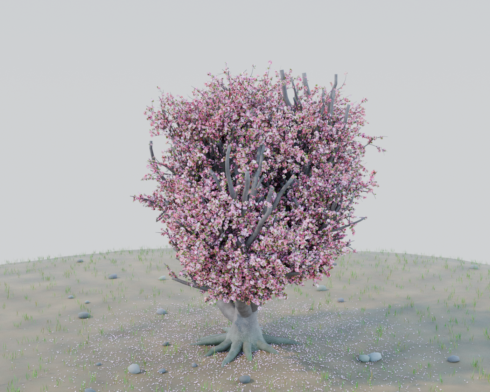

# albero_2 — Ciliegio in fiore (modello Blender)



Modello 3D molto dettagliato di un **ciliegio ornamentale in piena fioritura**
(Prunus serrulata), costruito **interamente in modo procedurale** dallo script
[`genera_ciliegio.py`](genera_ciliegio.py): nessuna geometria importata, nessuna
texture esterna, tutto nasce da codice e da nodi procedurali.

| | |
|---|---|
| File del modello | `ciliegio.blend` (Blender 5.0, Cycles) |
| Script generatore | `genera_ciliegio.py` |
| Anteprima | `anteprima.png` (render Cycles CPU 1400×1120, 110 campioni) |
| Ingombro | chioma ~7,5 m di diametro, albero alto ~6,8 m, terreno 28 m |
| Unità | metri (sistema metrico, scala 1:1) |
| Fioritura | 48 000 mazzetti ≈ 147 700 fiori e gemme (ogni fiore ha 5 petali, stami e pistillo) |
| Geometria | legno ~620 000 vertici + ~46,6 M di vertici di fiori (mesh condivise) |
| Materiali | 8 materiali procedurali |

## Cosa contiene il modello

**Struttura (collezione `Ciliegio`)**
- fusto corto e robusto (1,7 m) con **contrafforti** alla base e **radici
  superficiali** che emergono dal terreno, come nei ciliegi adulti
- ramificazione ricorsiva a **vaso**: 9 branche maestre molto aperte, fino a
  7 livelli, ~21 000 rami; il raggio si riparte tra i figli (modello "pipe"),
  i nodi si ingrossano alle forcelle e i rametti terminali **si incurvano verso
  il basso** sotto il peso della fioritura
- **potatura naturale**: il centro della chioma (in ombra) resta più vuoto,
  mentre la parte esterna e alta è fitta; nessun ramo esce dalla sagoma a vaso
  della chioma (i rami vengono ripiegati verso l'interno)
- corteccia di Prunus: grigio-bruna, con **lenticelle orizzontali** in rilievo,
  solchi longitudinali e **muschio** alla base

**Fioritura (collezione `Fioritura`)**
- 12 varianti di **mazzetto** costruite come mesh separate e istanziate
  ~48 000 volte (scala e rotazione casuali, **colore per oggetto** dal bianco
  puro al rosa carico): con mesh condivise si ottengono ~140 000 fiori con un
  file leggero
- ogni fiore è completo: **pedicello curvo**, calice a 5 sepali con ovario
  rigonfio, **5 petali** (qualche fiore a 6, alcuni **semidoppi** a 9-12) obovati
  con smusso apicale, nervatura incassata, coppa e arricciatura, poi stami con
  filamento e **antera gialla** e pistillo
- sulle stesse varianti ci sono **gemme non aperte** (più rosa) e **foglioline
  giovani bronzee**: la fioritura non è mai "uniforme", come nei rami veri
- i mazzetti sono distribuiti lungo tutto il legno fine (distanza media 8 cm),
  più radi sui rami grossi, e **ogni punta di ramo porta almeno un mazzetto**

**Terreno (collezione `Terreno`)**
- rilievo dolce con montagnetta al piede dell'albero; il bordo si incurva verso
  il basso, così l'orizzonte non è un taglio netto
- ~9 000 **petali caduti** distribuiti sotto la chioma (più densi in
  corrispondenza del bordo della chioma, dove cadono davvero)
- ~3 400 ciuffi d'erba (fili sottili piegati, con colore per vertice e qualche
  filo secco), sassi sparsi e chiazze di muschio nel materiale del terreno

## Rigenerare il modello

Serve il modulo Python di Blender (`pip install bpy`, testato con bpy 5.0.1):

```bash
cd albero_2
python3 genera_ciliegio.py                    # solo ciliegio.blend (~20 s)
python3 genera_ciliegio.py -- --render        # + anteprima.png (Cycles CPU)
python3 genera_ciliegio.py -- --render --samples 24 --res 700x560   # anteprima rapida
```

| Opzione | Effetto |
|---|---|
| `--render` | salva anche l'anteprima (`anteprima.png`) |
| `--samples N` | campioni Cycles (default 64) |
| `--res WxH` | risoluzione dell'anteprima (default 1400x1120) |
| `--quick` | render veloce (16 campioni) |

> Nota: la fioritura è generata con mesh condivise tra i mazzetti, quindi il file
> resta leggero (~36 MB) nonostante i ~47 milioni di vertici di fiori. Il render
> Cycles a 1400×1120 e 110 campioni dura ~13 minuti su 2 core. Su macchine con
> poca RAM conviene lasciare attivo `--no-denoise` (il denoiser di Blender è la
> parte più avida di memoria) oppure abbassare `MAX_CLUSTERS` e
> `BRANCH_BUDGET_PER_LIMB` in testa allo script.
