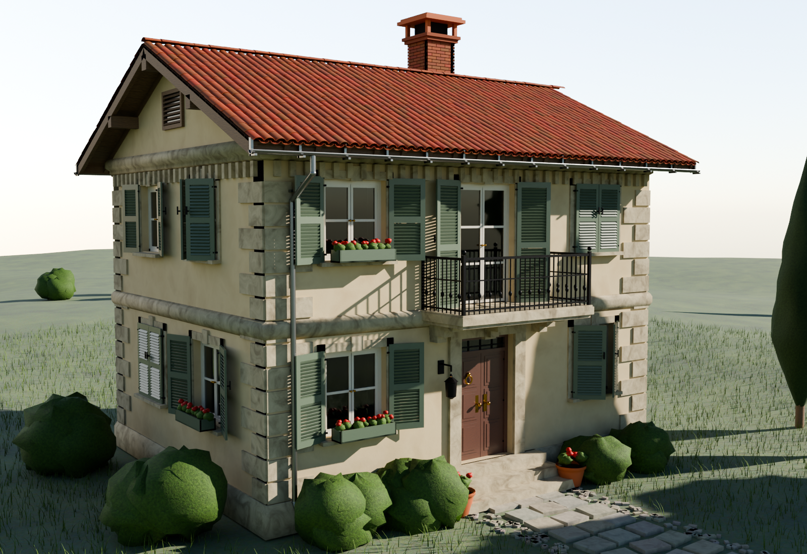

# casa_1 — Casale a due piani (modello Blender)



Modello 3D molto dettagliato di una casa di campagna a due piani con tetto a
falde in coppi, costruito **interamente in modo procedurale** dallo script
[`genera_casa.py`](genera_casa.py) (nessuna geometria importata o disegnata a mano).

| | |
|---|---|
| File del modello | `casa.blend` (Blender 4.2, Cycles) |
| Script generatore | `genera_casa.py` |
| Anteprima | `anteprima.png` (render Cycles 1600×1100) |
| Ingombro | 9,00 × 7,00 m, colmo a 8,00 m, comignolo a 9,5 m |
| Unità | metri (sistema metrico, scala 1:1) |
| Geometria | ~690 000 vertici, ~250 000 facce |
| Materiali | 26 materiali procedurali (nessuna texture esterna) |

## Cosa contiene il modello

**Muratura (collezione `Edificio`)**
- muri perimetrali con spessore reale di 35 cm e **vani passanti** (le finestre
  hanno spalle, soglia e architrave: guardando di sbieco si vede lo sguincio)
- zoccolo in pietra con gocciolatoio, **cantonali bugnati** agli angoli,
  marcapiano modanato, cornicione con **dentelli** (tutte le fasce hanno gli
  spigoli risolti a 45°)
- timpani con **occhio in pietra** su un lato e **grata di aerazione** in legno sull'altro
- solai e tramezzi interni, così che attraverso i vetri si intraveda un interno
  invece del vuoto

**Serramenti (collezione `Serramenti`)**
- 18 finestre e 2 porte: davanzale in pietra, mostra con chiave di volta,
  telaio fisso, ante con montanti/traversi, vetri e maniglie in ottone
- **persiane alla romana** con lamelle inclinate, traverso centrale, cardini e
  maniglietta; aperte, socchiuse o chiuse a seconda del vano
- **portone d'ingresso a due battenti** con pannelli a bugna, battacchio,
  pomoli e bocchette in ottone, sopraluce a raggiera, portale in pietra
  e gradinata; porta secondaria sul retro
- balcone con **mensole a voluta** e ringhiera in ferro battuto con balaustrini
- lanterna da esterno (accesa), cassette fiorite sui davanzali

**Tetto (collezione `Tetto`)**
- orditura completa: trave di colmo, arcarecci sporgenti, 40 travetti, tavolato
  a tavole singole, frontalino di gronda e tavole di bordo
- **~3 650 coppi posati uno a uno** (canali + coppi + colmo), ognuno con
  rotazione, scala e colore leggermente diversi (attributo di colore per tegola)
- grondaie con staffe, pluviali con gomiti e collari
- comignolo con **288 mattoni posati uno a uno** e mitra in cotto

**Giardino (collezione `Giardino`)**
- terreno a maglia polare di 90 m di raggio (fitto vicino alla casa),
  46 000 ciuffi d'erba, vialetto in lastre di pietra irregolari con ghiaia
- siepi, cespugli, cipressi, due alberi a foglia larga, vasi in cotto con gerani

**Scena** — cielo procedurale Nishita (la luce ambiente è attenuata rispetto al
cielo visibile in camera, così il sole resta protagonista), sole alle 26° di
elevazione, camera 40 mm con profondità di campo, Cycles + AgX.

## Rigenerare il modello

Serve il modulo Python di Blender 4.x (`pip install bpy`):

```bash
python3 genera_casa.py            # ricostruisce casa.blend
python3 genera_casa.py --render   # ricostruisce e renderizza anteprima.png
```

La costruzione della geometria richiede circa 2 secondi; il render di anteprima
(1600×1100, 96 campioni, denoiser) qualche minuto su CPU.

Il risultato è deterministico: tutte le variazioni casuali (posa dei coppi,
mattoni, erba, lastre del vialetto) derivano dal seme `SEED = 20261010`.
