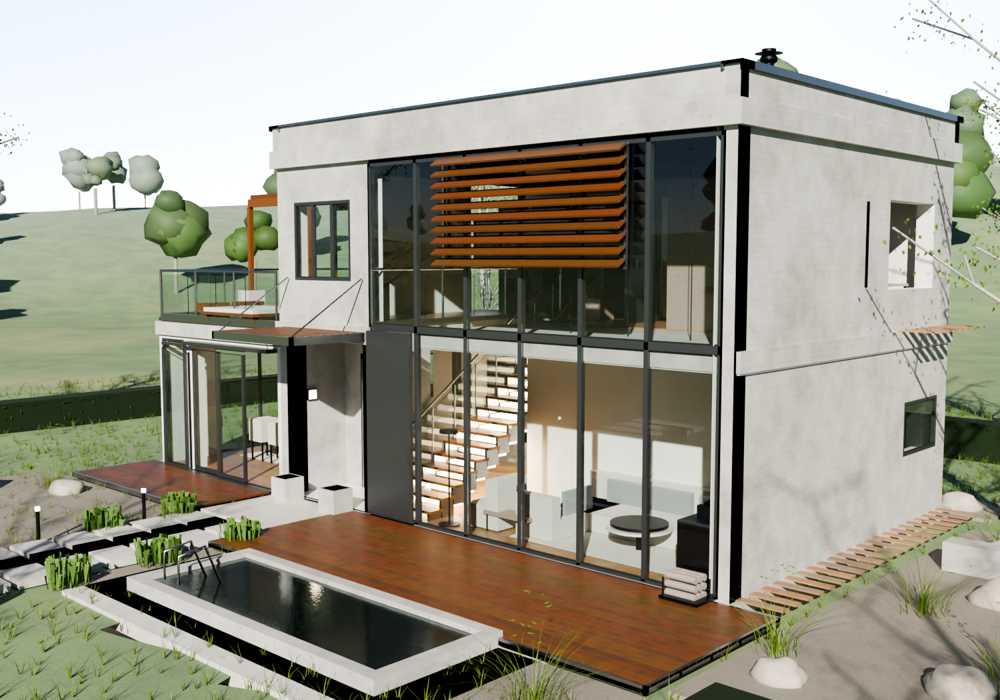

# casa_2 — Villa contemporanea (modello Blender)



Modello 3D molto dettagliato di una **villa contemporanea su due livelli** con
volumi sfalsati, facciata vetrata a doppia altezza, ala a un piano con terrazza
praticabile, piscina a sfioro e giardino disegnato. Tutto è costruito
**interamente in modo procedurale** dallo script
[`genera_villa.py`](genera_villa.py): nessuna geometria importata, nessuna
texture esterna, ogni elemento nasce da codice.

| | |
|---|---|
| File del modello | `villa.blend` (Blender 4.2, Cycles) |
| Script generatore | `genera_villa.py` (~3 100 righe) |
| Anteprima | `anteprima.png` (render Cycles 1500×1050, 96 campioni) |
| Ingombro | corpo 9,6 × 7,2 m, ala 4,4 × 4,8 m; parapetto a 7,07 m, camino a 7,5 m |
| Unità | metri (sistema metrico, scala 1:1) |
| Geometria | ~815 000 vertici, ~350 000 facce |
| Materiali | 39 materiali procedurali (nessuna texture esterna) |
| Seme casuale | `SEED = 20261012` (risultato deterministico) |

## Differenze rispetto a `casa_1`

`casa_1` è un casale tradizionale: muri in intonaco, coppi posati uno a uno,
persiane, comignolo in mattoni. `casa_2` è il suo opposto: **architettura
moderna** — setti in calcestruzzo a vista, facciata continua in alluminio e
vetro, brise-soleil in listelli di legno, tetto piano con parapetto e
fotovoltaico, ala a un piano con **terrazza praticabile**, piscina a sfioro e
giardino disegnato. Cambiano anche tipologia (due volumi sfalsati invece di un
blocco con tetto a falde) e paesaggio (prato all'inglese con deck in teak).

## Cosa contiene il modello

**Struttura (collezioni `Edificio` e `Serramenti`)**
- platea con zoccolo in ghiaia, solai in calcestruzzo con bordi a vista, muri
  perimetrali spessi 30 cm con **vani passanti** (spalle, soglie e architravi
  reali) e tramezzi interni in cartongesso
- tre volumi: corpo principale a due piani, corpo centrale vetrato a doppia
  altezza, **ala a un piano** (pranzo) con terrazza praticabile sul tetto
- facciata sud **continua e vetrata** (6,2 × 5,9 m) con montanti in alluminio
  ogni 1,13 m, traversa di piano, vetri veri e un'**anta scorrevole aperta**
  che lascia entrare lo sguardo in casa
- **nicchia d'ingresso** rivestita in cemento a vista con porta a bilico in
  acciaio e piastra in legno, maniglione, cardini, citofono, cassetta postale,
  numero civico, applique e zerbino; **pensilina** in doghe di legno con
  tiranti in acciaio e fioriere in calcestruzzo
- **brise-soleil** in listelli di legno inclinati a 32° sulla parte alta della
  facciata vetrata e rivestimento in doghe verticali sulla parete della terrazza
- calcestruzzo a vista con **impronte delle tavole dei casseri** e **fori dei
  tiranti disposti a griglia** (calcolati nei nodi del materiale)

**Copertura e terrazza (collezione `Tetto`)**
- tetto piano: massetto in ghiaia, parapetto perimetrale con **copertina in
  lamiera** e gocciolatoio, **scarichi con griglia** e pluviali con collari
  posati sulle facciate
- **8 pannelli fotovoltaici** su due file inclinate di 22°, con struttura di
  supporto in acciaio, più **camino della stufa** (canna in acciaio che
  attraversa il vuoto a doppia altezza), sfiato della colonna di scarico e
  **lucernario** sul vano scala
- terrazza praticabile in **deck di teak** con profili di bordo, **parapetti in
  vetro temprato** con corrimano e montanti in acciaio, **pergola in legno**,
  due lettini con cuscini, tavolino e fioriere

**Interni (collezione `Interni`, tutti visibili attraverso i vetri)**
- **pavimenti in rovere** a listoni, ognuno con tinta leggermente diversa
  (attributo di colore per vertice), controsoffitti con **faretti incassati**,
  plafoniera lineare e tre lampade a sospensione nel vuoto a doppia altezza
- **cucina** con basi, colonne frigo/dispensa e forno, piano in marmo, lavello
  con rubinetteria, fuochi sul piano dell'isola, sgabelli e tre lampade in rame
- **soggiorno** a doppia altezza: divano a L con cuscini, poltrona, tavolini in
  marmo e noce, **stufa a legna** con canna fumaria e catasta, **libreria a
  tutta altezza con libri** uno per uno, tappeto, pianta in vaso e lume
- **pranzo nell'ala**: tavolo in noce con sei sedie, credenza, quadro, runner,
  vasellame e piante
- **scala** in acciaio e rovere: 17 pedate con traversine a vista, parapetto in
  vetro con corrimano, **luce a LED** sotto la rampa
- **piano primo**: camera con letto rifatto (cuscini, plaid, testiera
  imbottita), comodini con abat-jour, armadio con anta a specchio, scrivania
  con portatile e sedia, quadro e pianta; **bagno padronale** con doccia filo
  pavimento, soffione, sanitari sospesi, lavabo in marmo, specchio e
  rivestimento in gres; **cabina armadio** con ripiani e vestiti; ballatoio con
  **parapetto in vetro**, libreria, poltrona, tappeto e quadri
- porte interne con telaio, anta e maniglia; interruttori e prese a parete

**Giardino e paesaggio (collezione `Giardino`)**
- prato all'inglese su terreno a maglia polare (170 m) che sale in **colline**
  all'orizzonte; **11 000 ciuffi d'erba** con fili a raggiera (alcuni secchi)
- **deck in teak** esterni, **piscina a sfioro** con orlo in cemento gettato,
  pareti, fondo, gradino sommerso, acqua trasparente e scaletta in acciaio
- **vialetto** in lastre di calcestruzzo con fughe d'erba, piazzale d'ingresso
  e quattro luci a paletto; **aiuole di ghiaia** con massi naturali, panca in
  calcestruzzo, **graminacee** e **lavande**
- **siepi potate** di confine con anima scura e foglie posate una a una,
  **betulle a più fusti** con corteccia bianca e lenticelle, alberi a foglia
  larga e cipressi modellati foglia per foglia
- paesaggio di fondo: macchie di alberi e filari di cipressi sulle colline,
  sfumati da una **foschia atmosferica** che cresce con la distanza

**Scena** — cielo procedurale Nishita, sole alle 26° di elevazione da sud-ovest
(la luce ambiente è attenuata rispetto al cielo visibile in camera), camera
38 mm con profondità di campo, Cycles + AgX.

## Rigenerare il modello

Serve il modulo Python di Blender 4.x (`pip install bpy`):

```bash
cd casa_2
python3 genera_villa.py                          # ricostruisce villa.blend (~2 s)
python3 genera_villa.py --render                 # + anteprima.png (Cycles CPU)
python3 genera_villa.py --render --res 900x630 --samples 24   # anteprima rapida
```

| Opzione | Effetto |
|---|---|
| `--render` | salva anche l'anteprima (`anteprima.png`) |
| `--samples N` | campioni Cycles (predefinito 96) |
| `--res WxH` | risoluzione dell'anteprima (predefinita 1500x1050) |
| `--cam px,py,pz,tx,ty,tz` | posizione e bersaglio della camera (per viste di controllo) |

La costruzione della geometria richiede circa 2 secondi; il render di anteprima
(1500×1050, 96 campioni, denoiser) qualche minuto su CPU. Il risultato è
deterministico: tutte le variazioni casuali (listoni del deck, foglie, libri,
massi, alberi di sfondo) derivano dal seme `SEED = 20261012`.
