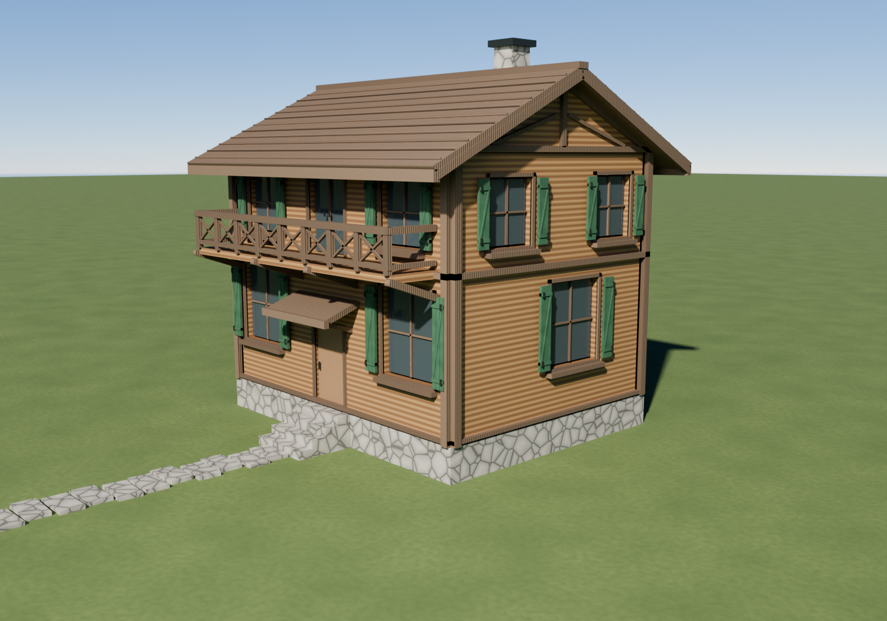

# casa_3 — Chalet alpino rifinito



Modello procedurale di uno **chalet alpino a due piani**, con basamento in
pietra, rivestimento in legno caldo e tetto a falde molto sporgenti. È il terzo
tipo di casa della raccolta, dopo il casale tradizionale di [`casa_1`](../casa_1)
e la villa contemporanea di [`casa_2`](../casa_2).

La geometria e i materiali sono generati dallo script
[`genera_chalet.py`](genera_chalet.py): non usa mesh, texture o immagini
esterne. Le colorazioni del legno, della pietra e del prato sono procedurali.

| | |
|---|---|
| Modello | `chalet.blend` (Blender 4.2+ / 5.0, Cycles) |
| Generatore | `genera_chalet.py` |
| Anteprima | `anteprima.png` (Cycles, 1500 × 1050, 96 campioni) |
| Ingombro del corpo | 9,0 × 7,0 m; muri spessi 28 cm |
| Ingombro del tetto | circa 10,2 × 8,9 m; pendenza 26° |
| Colmo / comignolo | circa 9,3 m / 10,0 m |
| Materiali procedurali | 8, nessuna texture esterna |

## Dettagli del modello

- **Struttura** — zoccolo in pietra con gradinata, muri con spessore reale e
  aperture passanti, cantonali e fasce in legno scuro; travatura decorativa
  sul timpano.
- **Facciate** — vetri incassati, serramenti a riquadri, davanzali e persiane
  verdi a doghe con ferramenta scura; portafinestra verso il balcone.
- **Esterni** — balcone superiore con pavimento in tavole, parapetto a croce e
  saettoni; pensilina sopra l'ingresso e vialetto di lastre in pietra.
- **Copertura** — due falde in legno scuro, corsi leggermente rilevati, colmo,
  bordi rifiniti e comignolo in pietra.
- **Scena** — prato, cielo fisico a quota montana, sole e luce di riempimento
  morbida; camera prospettica e render Cycles con AgX.

## Rigenerare il modello

Serve il modulo Python di Blender 4.x/5.x (`pip install bpy`):

```bash
cd casa_3
python3 genera_chalet.py                          # ricostruisce chalet.blend
python3 genera_chalet.py --render                 # + anteprima completa
python3 genera_chalet.py --quick                  # anteprima rapida
python3 genera_chalet.py --render --res 900x630 --samples 24
```

| Opzione | Effetto |
|---|---|
| `--render` | salva anche l'anteprima (`anteprima.png`) |
| `--quick` | anteprima rapida (840 × 588, 20 campioni) |
| `--samples N` | campioni Cycles (predefiniti 96) |
| `--res WxH` | risoluzione (predefinita 1500 × 1050) |
| `--cam px,py,pz,tx,ty,tz` | posizione e bersaglio della camera |

La geometria è deterministica e richiede pochi secondi; il render completo può
richiedere alcuni minuti su CPU.
