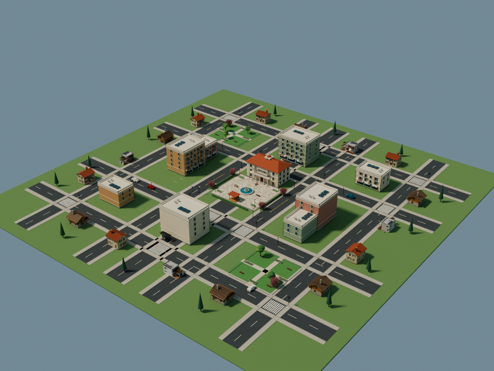

# prova_citta_1 — Borgo delle Querce



Una **città italiana in miniatura**, impostata come diorama urbano: centro
civico, isolati commerciali e residenziali, strade alberate e quartieri di case.
È costruita riutilizzando i modelli Blender già presenti nel repository e
aggiungendo geometria procedurale per collegarli in un unico contesto.

## Cosa contiene

- municipio con portico, torre dell'orologio, tetto in coppi e ingresso su
  **Piazza delle Querce**;
- fontana, pavimentazione in lastre, caffè all'aperto, panchine, lampioni,
  aiuole e due piccoli parchi;
- **sei palazzi** residenziali/commerciali con vetrine, balconi, tende, insegne,
  marcapiani e pannelli solari;
- **sedici case** istanziate dai modelli esistenti: casale, villa contemporanea
  e chalet alpino;
- viali, incroci rialzati, marciapiedi, attraversamenti pedonali, segnaletica,
  automobili, autobus e pensilina;
- ciliegi fioriti ripresi dal modello `albero_2` e alberature urbane procedurali.

La scena ha dimensioni di circa **214 × 214 metri** ed è organizzata in
collezioni Blender distinte per edifici, strada, verde, arredo e mobilità.
Il file finale incorpora i modelli importati, quindi può essere aperto da solo
una volta generato.

## File

| File | Contenuto |
|---|---|
| `citta.blend` | Scena 3D completa, camera e impostazioni Cycles |
| `anteprima.png` | Render panoramico del borgo |
| `genera_citta.py` | Script procedurale e importazione dei modelli esistenti |

## Rigenerazione

Serve **Blender 5.0 o successivo** e le cartelle originali `casa_1`, `casa_2`,
`casa_3` e `albero_2` nella cartella superiore del repository. Dalla cartella
del progetto:

```bash
python3 genera_citta.py                 # genera citta.blend
python3 genera_citta.py --quick          # genera anche un'anteprima rapida
python3 genera_citta.py --render         # render Cycles a qualità alta
```

Il file `.blend` è salvato con le impostazioni di render finali; `--quick`
riduce temporaneamente campioni e risoluzione solo per il PNG di controllo.
